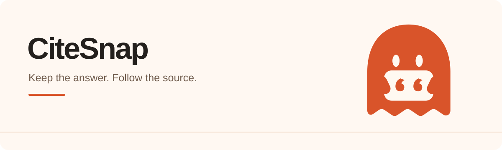
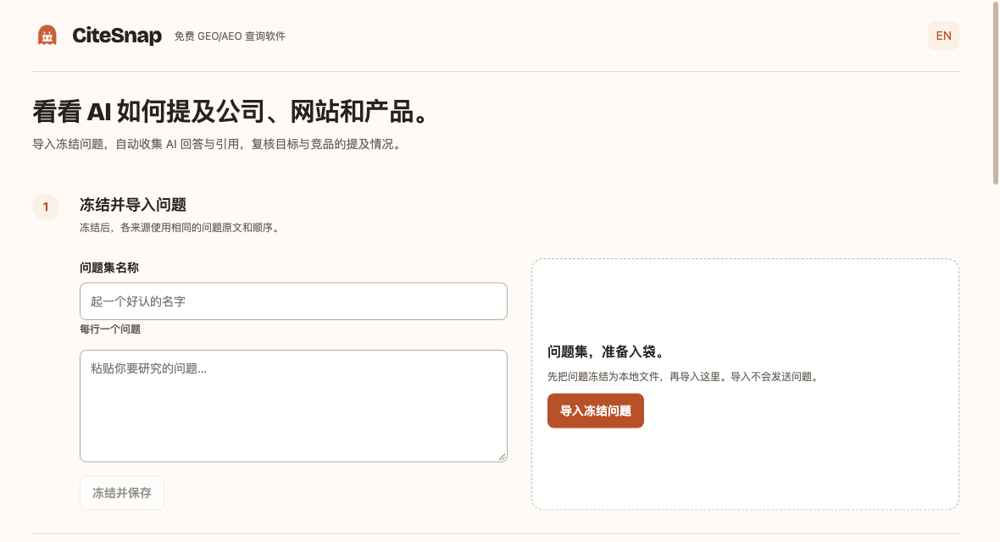

# CiteSnap

免费查询 AI 对公司、网站、产品等对象的提及情况。

CiteSnap 是一款面向 GEO/AEO 优化的脚本软件。导入冻结的问题集，登录自己的账号并勾选 AI 平台后，程序会自动提问，收集回答原文及其中引用的链接。

用同一组问题对照目标与竞品，查看提及情况和引用来源。你可以据此发现内容与提及上的差距，调整 GEO/AEO 优化方向，争取在 AI 回答中获得比竞品更多的提及。

[下载 Mac 测试版](https://github.com/maxuod/CiteSnap/releases/tag/v0.2.6-beta.1) · [安装与首次登录](docs/INSTALL.md#中文安装与首次登录) · [English](README.md)

## 先试一次采集

*0.2.6 测试版的实际界面，截图使用空白本地工作区。*

当前下载为 **CiteSnap 0.2.6 测试版**。问题、证据和独立登录资料保存在你的电脑上。

测试版适用于 M1 及更新芯片的 Mac，系统需 macOS 13 或以上。Intel Mac、Windows 和 Linux 暂无安装包。下载 DMG 后，将应用拖入 Applications（应用程序）。

本包有本地构建签名，尚未完成 Apple Developer ID 正式签名和公证。macOS 可能要求你在“隐私与安全性”中单独确认打开；具体提示见[安装指南](docs/INSTALL.md#中文安装与首次登录)。另一台干净 Mac 下载后的安装情况还没有实测。

首次使用时，点击“准备采集浏览器”，程序会从 Google 官方下载约 183 MB，核对固定哈希后保存在本机。用户无需安装 Node、运行终端命令、填写 API 密钥或注册 getaudit 账号。

1. 填写问题集名称，每行输入一个问题，点击“冻结并保存”。文件会保留原文、顺序和校验哈希。
2. 导入保存的冻结文件。之后需要用同一组问题再次观察时，可以继续使用它。
3. 准备浏览器，勾选来源，打开对应的账号窗口。自己完成登录后回到应用，等到“账号已确认”；必要时点击“检查”。
4. 核对计划请求数，阅读并确认账号与网络提示，再点击“开始采集”。
5. 在结果中查看原始回答和引用，点击“导出证据”保存 JSON 文件。

第一次建议只用一个问题和 Copilot。导入、登录和查看已有结果不会自动开始采集。

复核一组回答时，可以先看目标公司、网站或产品出现在哪些问题里，再对照同一回答中的竞争对手。引用链接能让你回到具体页面，检查 AI 使用了哪些来源，以及自己的网站是否覆盖了相关内容。

当前的提及判断和竞品比较，需要基于保存的回答复核。优化后若要观察变化，可以再次导入同一份冻结文件，确认重复提问的提示后发起新一轮查询。问题相同有助于对照，结果仍会受到平台、账号、时间和网络环境影响。

## 当前验证到哪一步

较早的构建通过一位用户的 Copilot 账号完成过一次自动采集，保存了 2,745 字符正文和 6 个引用网址；最终解析器与同一段原对话核对过。另一次提取失败的记录仍保留，内容从原对话只读恢复，没有重新发送问题。

ChatGPT Search、Gemini、Perplexity、Grok 和 Google AI Overview 已有适配器，但尚未完成真实账号采集验收。0.2.3 的浏览器准备、采集与导出流程另做了本地及模拟页面检查，不能据此认定所有平台、账号都能用。版本、日期和检查范围见[验证记录](docs/VALIDATION.md)。

## 账号、地区与证据

频繁或大量自动提问可能触发验证、限流、暂停或封号。程序顺序执行，请求间隔 45 秒，并设有每来源滚动 24 小时 50 次开始的本地限制。这些设置不是账号安全保证。访问受限会停止采集，已提交但结果未知的任务会保留，不自动重发。

采集使用这台电脑当前的网络和浏览器默认环境，没有地区或代理切换功能。系统 VPN、代理可能影响出口；程序没有核实物理位置和网络国家。平台、账号和网络地区都会影响访问与结果。

登录资料保存在应用自己的独立目录，与你的个人浏览器分开。程序没有证据上传功能或统计 SDK；准备浏览器会连接 Google，开始采集才会向选定平台发送冻结问题。导出可能含客户内容，分享前请查看[隐私说明](PRIVACY.md)。

没抓到回答或引用，不代表平台没有提供。哈希用于与可信原件比对文件是否改变，不能证明内容由平台认证。

## 开源与参与

源码按 [MIT 许可证](https://github.com/maxuod/CiteSnap/blob/main/LICENSE)免费开放。第三方软件和单独下载的浏览器适用各自的[许可与条款](https://github.com/maxuod/CiteSnap/blob/main/NOTICE.md)。采集与 getaudit 的托管分析分别运行。

开发步骤见 [Contributing](CONTRIBUTING.md)，漏洞反馈见 [Security](SECURITY.md)。提交问题时请提供脱敏说明和合成问题，不上传密码、Cookie、登录目录或客户原始导出。关于项目的定位，见 [About](ABOUT.md)。
